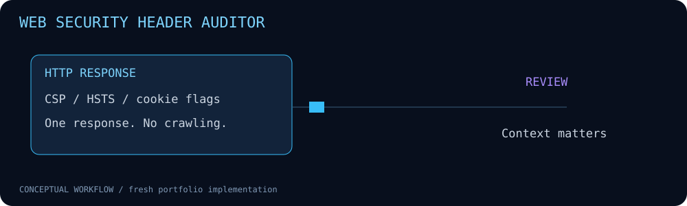

# Web Security Header Auditor



Single-response linting for CSP, HSTS, framing, nosniff, referrer policy and cookie flags.

**Fresh portfolio implementation • Python 3.10+ • Standard library only**

## Run

```bash
python3 --version
python3 auditor.py --fixture examples/headers.json
python3 -m unittest discover -s tests -v
```

## Implemented behavior

- Offline fixtures or one explicit HEAD request. HTTPS uses Python's default certificate verification.
- Redirects are NOT followed. A 3xx or 405 is reported as-is; the tool never silently switches to GET.
- Duplicate headers and cookie attributes are inspected; cookie values are omitted from findings.
- Findings request review. There is no pass score or claim of exploitability.

## Scope and limitations

Only header syntax heuristics are checked. CSP parsing is deliberately limited (first policy, no full browser evaluation); multiple policies, nonce/hash interaction and application requirements need manual assessment. Cookie checks do not identify session cookies. No HTML/meta policy parsing, redirect-chain checks, CORS analysis, TLS grading or cookie-jar evaluation. Live mode is a local CLI, not a hardened public URL-fetching service. Do not expose it as a server-side fetch endpoint. Network errors exit 2. Exit 0 means collection completed, even if review findings exist.

## Validation

7 unit tests passed locally on Python 3.12.14. Synthetic CLI examples were executed and results are included under `examples/`. No customer data, historical lab results or production effectiveness is claimed. CI configuration is supplied; remote CI status must be checked after publishing.

## Files

- `auditor.py` — implementation and CLI.
- `tests/test_main.py` — regression and boundary tests.
- `examples/` — synthetic inputs and generated output.
- `assets/workflow.svg` — project-specific animation with reduced-motion support.
- `.github/workflows/ci.yml` — pinned-action CI.

## Safe operation

Use inputs and hosts you own or are authorized to assess. Review reports before publication; real files, headers and logs can contain sensitive information. These tools do not establish that a system is secure or compromised.

## Reference

https://developer.mozilla.org/en-US/docs/Web/HTTP/Reference/Headers/Content-Security-Policy
